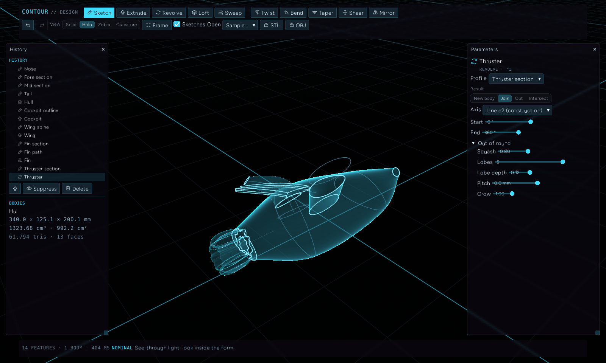

# Contour Design

CAD for designers: draw curves on a plane, raise them into bodies, and keep shaping. It is the
first app on the shared [CAD foundations](CAD_FOUNDATIONS.md), and it leans on the two things that
foundation is built to do well: **curves** and **asymmetry**.



```bash
cd examples/studio-bundle
```
```bash
npm run build-cad-design
```
```bash
cargo run --bin example --release -- cad-design
```

It opens on the **Skiff**, a small craft in which nothing is mirrored: a hull lofted through four
unlike sections on tipped planes, a cockpit cut that narrows and drifts as it goes down, a single
wing made from one stroked curve, a fin swept along a spline, and a fluted thruster. Select any
feature in the history and change it; everything after it follows.

## The idea

Most CAD starts from the symmetric and the straight and makes you work to leave them. Here the
controls for leaving them are on every feature from the start:

- A sketch plane can be offset and **tipped**; lofts between tipped planes lean.
- A spline point has a **tension** (or, on a control spline, a pull), so one side of a curve can
  be made fuller without adding points. Turn on the **curvature comb** to see how fair it is.
- A **stroke** gives an open curve a body with different widths left and right, swelling or
  tapering along its length: a wing, a blade, a wall.
- An **extrude** has two sides, each with its own distance, scale, shift, twist and bulge.
- A **revolve** can stop anywhere, squash, grow lobes, climb into a coil or widen into a shell.
- A **loft** joins sections that do not match, and each section can spin the skin.
- **Deformers** (twist, bend, taper, shear) act between `From` and `To` along a body, not on all of it.
- A **mirror** can scale and shift the half it makes.

## Working in it

The window is the 3D view, with four panels over it.

| Panel | What it is for |
|---|---|
| Tool bar (top) | In the model: Sketch, Extrude, Revolve, Loft, Sweep, the deformers, Mirror; view mode, Frame, samples, export. In a sketch: the drawing tools and Done. |
| History (left) | Every feature in order. Select one to edit it; suppress, reorder or delete it. Below: each body's size, volume, area and triangle count. |
| Parameters (right) | The selected feature's controls. In a sketch: the selected curve or point. |
| Readout (bottom) | Cursor position and grid while drawing; feature and body counts, evaluation time, and `NOMINAL` or the number of issues. |

**Camera**: right-drag orbits, middle-drag pans, the wheel zooms, `F` frames the model or the
selected body. Click a body to select the feature that made the face under the pointer.

**Sketching**: press **Sketch** (it starts on the ground plane with the Spline tool; change the
plane in its parameters). While you draw, bodies turn to faint light so the sketch stays visible
inside them.

| Tool | Key | How |
|---|---|---|
| Select | `V` | Click a curve or point; drag to move. Drop a point on another to join them. Shift adds. |
| Line | `L` | Click points; click the last again to stop, the first to close. |
| Rectangle | `R` | Two opposite corners. |
| Circle | `C` | Centre, then a point on it. |
| Ellipse | `E` | Centre, the end of one axis, then the width. |
| Arc | `A` | Start, end, then pull the bulge. |
| Spline | `S` | Points the curve passes through; click the last again to finish, the first to close. |
| Control spline | `B` | Control points that pull the curve. |

The cursor snaps to points, line midpoints and curves, then to the grid (half the fine grid
spacing, which follows zoom). Closed shapes fill in: that is a profile a feature can use. `Esc`
ends the tool, then leaves the sketch; `Del` deletes the selection; `Ctrl+Z` / `Ctrl+Shift+Z`
undo and redo.

**View modes**

| Mode | Use |
|---|---|
| Solid | Dark machined metal with lit edges. |
| Holo | See-through light: look inside, check a cut. |
| Zebra | Reflection stripes. A kink in a stripe is a kink in the surface. |
| Curvature | Colour by how tightly the surface bends, relative to the view. |

**Export**: STL (binary) and OBJ (smooth normals, one group per face). Units are millimetres.

The document saves itself to `session.json` in the app's data folder after every change.

## Samples

| Sample | Shows |
|---|---|
| Skiff | Loft through unlike sections, cut, stroke, sweep, lobed revolve. |
| Vessel | A wall made from an uneven stroke, revolved squashed and lobed, then bent and twisted over part of its height. |
| Pebble | One closed spline (with per-point tension) extruded two ways with scale, shift and bulge. |

They are built in `design_samples.ts` with the same helpers the app uses, and double as worked
examples of the document format.

## MCP tools

Everything the panels do is available to agents (and is how the live test drives the app).

| Tool | Does |
|---|---|
| `cad_state` | Features, bodies (size, volume, area), sketch regions, issues. |
| `cad_document` | The whole document as JSON, or one feature. |
| `cad_new` | A new document: empty or a sample. |
| `cad_sketch` | Adds a sketch, or draws more into one, from shapes: spline, circle, ellipse, rectangle, polyline, line, arc. Shapes sharing a position are joined. |
| `cad_feature` | Adds an extrude, revolve, loft, sweep, deform or mirror. |
| `cad_update` | Merges new values into a feature. |
| `cad_remove` | Deletes a feature and what depends on it. |
| `cad_select`, `cad_edit_sketch` | Selection; entering and leaving a sketch, choosing a tool. |
| `cad_view` | View mode, viewing direction, framing a body, looking square at a sketch. |
| `cad_undo` | Undo or redo. |
| `cad_export` | Writes STL or OBJ. |

## Tests

| Tier | Where | Run |
|---|---|---|
| Kernel | `crates/entropy-cad` (unit tests, plus the samples evaluated headlessly) | `cargo test` in that folder |
| Document helpers and samples | `examples/studio-bundle/tests/cad_doc.test.ts`, `cad_design_samples.test.ts` | `npm run test:cad` |
| The real window | `tests/features/cad_design_live.feature` via `tests/cad_design_live.rs`: opens the Skiff, reshapes it mid-history, captures each view mode, draws a closed spline with the pointer, extrudes, lofts, twists, mirrors, undoes, exports | `xvfb-run -a cargo test --test cad_design_live` (after `npm run build-cad-design`) |

After changing a sample, run `npm run cad:fixtures` to refresh the JSON the kernel tests read.
Screenshots from the live run are kept under `test-artifacts/`.
