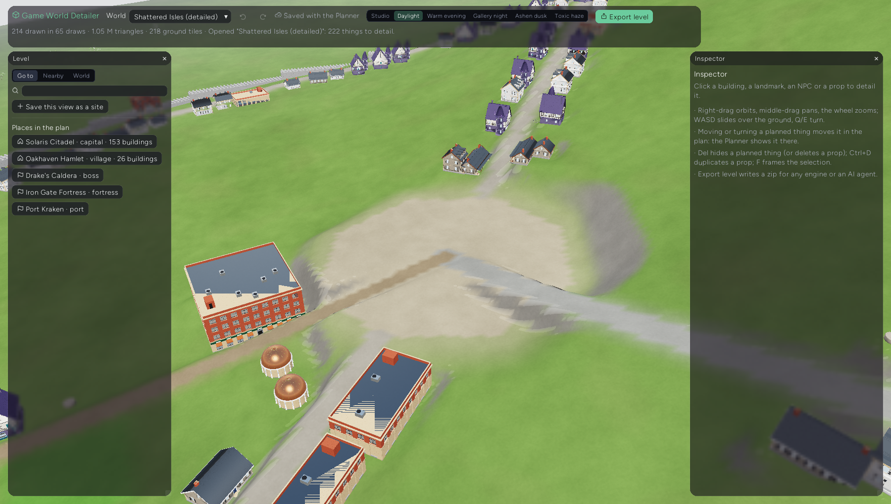
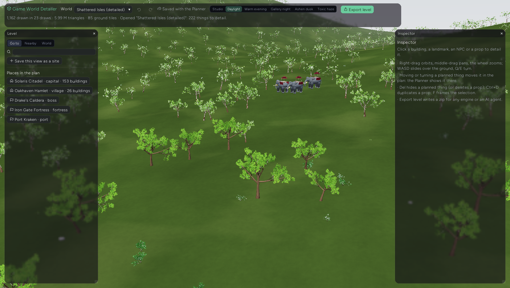
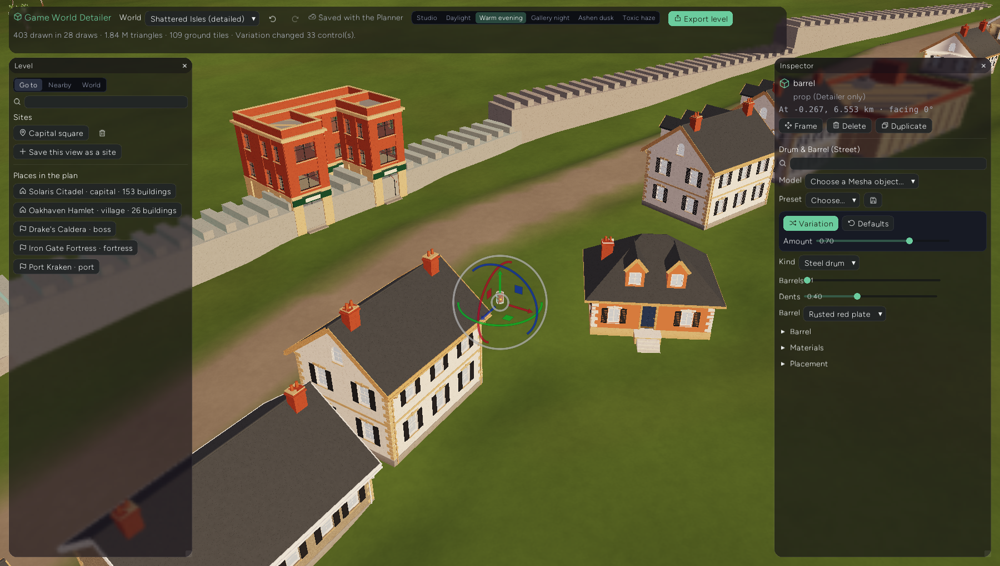

# Game World Detailer: the Planner's world, in 3D, with Mesha models

The Game World Detailer (`cargo run --bin example -- game-detailer`) is the third app of the game
world suite. [Mesha](MESHA_APP.md) makes procedural 3D models; the
[Game World Planner](GAME_WORLD_PLANNER.md) lays a world out from above (terrain, roads, towns
building by building, NPCs and creatures, painted forests and fields, quests). The Detailer opens
**the same world file** in 3D, up close, with every planned thing standing as a Mesha model, and
is where a level designer refines it before handing it off.

The 3D work stays out of the Planner on purpose: the Planner stays a fast, orthographic, map-first
tool; the Detailer is a 3D level editor.

## One set of files, both ways

| What | Where | Who edits it |
| ---- | ----- | ------------ |
| The world | the Planner's `worlds/<id>.world.json` (`<data>/game-world-planner/`) | both: the plan in the Planner; building, spot and NPC positions and headings in either; `world.detail` in the Detailer |
| Mesha presets | Mesha's `presets/<objectId>.json` (`<mesha data>/Mesha/`) | both: presets saved in Mesha are offered in the Detailer, presets saved in the Detailer show up in Mesha |
| Mesha models | the library (`apps/mesha/library`) | a Detailer model is an object id plus parameter values, exactly what a Mesha scene stores |

- **Moving or turning a planned thing in 3D edits the plan.** Drag a house with the gizmo and the
  Planner's footprint moves; turn it and its `rotationDeg` changes; the ground is re-leveled under
  it. Spots and codex placements (NPCs, creatures) move the same way. Props (things the plan
  doesn't have) live in the Detailer's own section.
- **The Detailer's own data rides along in `world.detail`** (see `detail_types.ts`): which model
  stands for one building (`bindings`) or for a whole kind (`models["structure:inn"]`,
  `"spot:ruin"`, `"codex:<entry>"`, `"category:creature"`), props, scatter rules per painted mark,
  ground materials, sites (saved views), lighting and viewport quality. The Planner carries it
  untouched, so copy, save-as and the library just work.
- **Both apps can be open at once.** Each watches the open world's file (`world_sync.ts`
  `WorldFileWatcher`: a folder listing every ~1.2 s; files carry who saved them, `savedBy`). With
  no unsaved edits an app simply takes the other's save in; with unsaved edits it runs a
  **three-way merge** (`mergeWorlds(base, mine, theirs)`): lists of things with ids merge entity
  by entity and field by field, so the Planner renaming an inn and the Detailer moving it both
  survive; where both changed the same field, the app's own value wins and the status line says
  so. Before every save an app takes the other's latest save in first. The Detailer saves on its
  own shortly after each edit (one undo step = one save); the Planner saves on Ctrl+S as before.

### Data folders

`game-detailer` uses the Planner's data folder (`../game-planner-data`, or
`ENTROPY_DETAILER_BDD_DATA` / `ENTROPY_PLANNER_BDD_DATA`) and links Mesha's store to Mesha's own
data folder (`../mesha-data/Mesha`, or `ENTROPY_MESHA_BDD_DATA`). Two engine additions make this
possible:

- `EntropyApp::with_linked_store(name, dir)`: the store named `name` lives in `dir` instead of
  `<data_dir>/<name>/` (`helpers/addon_store.rs`).
- `addon.IO.storeOf(name)`: another addon's store, only for names the addon lists in
  `sharedStores` when it registers (`Addon.register({ ..., sharedStores: ["game-world-planner", "Mesha"] })`).

### In the Creative Suite

The Detailer is also a tab of the Creative Suite (`npm run build-creative-suite`, then
`cargo run --bin example -- creative-suite`), next to Mesha and the Planner on the taskbar. There
every app's store is a folder under the suite's one data folder (`../cc-manager`), so the Planner,
the Detailer and Mesha share worlds and presets with no linked store. `build-creative-suite` also
bundles the model worker (`dist/game_detailer_worker.js`).

The engine has one camera, orbit control, sun and gizmo. Mesha and the Detailer each call
`claimView` (`apps/shared_view.ts`) at the top of their `onUpdate`, which only runs for the active
tab: on the first frame back after the other one had the view, an app puts back its own camera,
orbit control, lighting and gizmo. Tiling Mesha and the Detailer side by side is untested: with
one camera, at most one of them can be framed right.

## What it shows

Open a world (the toolbar's world list is the Planner's library; with an empty library, **Create a
sample world** saves the Shattered Isles with its capital and village laid out, woods and fields
painted, a guard and a pack of creatures, into the Planner's library). The view starts at the
biggest settlement.

- **Ground**: the Planner's heightfield interpolated with Catmull-Rom (bicubic), plus what the plan
  does to it: every building footprint stands on a level pad blended into the slope; roads,
  trails, highways and town streets lie on smoothed, leveled beds; rivers cut a bed with water
  just under the banks; plazas and markets are leveled; fractal micro-relief (scaled to the
  heightfield's cell size) breaks up open land and fades out where the plan leveled it. Colors
  come from the painted marks (forest floor, meadow, farmland, sand, snow, ash...), roads and
  streets, beaches by the sea and rock on steep ground (`detail_ground.ts`).
- **Buildings**: every footprint as a Mesha object chosen by genre and kind, sized to it. A house
  is `architecture.house` with its width, depth and storeys from the plan (sizes snap to 0.5 m so
  similar houses share one mesh); an L-, T- or U-shaped footprint becomes one building per wing;
  halls, barracks and keeps are `architecture.city_block`; temples domes; towers stone towers;
  sci-fi, post-apocalyptic and cyberpunk worlds get their own (hab lodges, depots, rust domes,
  towers). Walls are stone runs with crenellations, wells and docks simple builtins
  (`detail_models.ts`).
- **Landmarks** at spots without buildings: a ruin, a shrine, a cave dwelling for dungeons and
  mines, a burn barrel for camps, the behemoth for a boss, crystals for a landmark.
- **NPCs and creatures** from the codex placements, a group standing in a loose cluster.
- **Scatter** from painted marks: trees, shrubs, ferns and rocks in a forest, grass and flowers in a
  meadow, conifers, palms, reeds, boulders... at instances per hectare scaled by the paint's
  density, kept off water, roads, streets, plazas and pads, and off ground too steep
  (`detail_scatter.ts`). Each 128 m tile grows from its own seed, so a tile always grows the same
  plants, in the viewport and in the export.

Everything is drawn with Mesha's own viewport shader (`detail_shader.ts` derives it), so a model
looks in the level exactly as it does in Mesha; the Detailer adds the ground and water surfaces,
a breeze in leaves and grass, and lighting from Mesha's studio presets (Daylight, Warm evening,
Gallery night, Ashen dusk...).

## Editing

| Action | How |
| ------ | --- |
| Orbit, pan, zoom | right-drag, middle-drag, wheel |
| Slide over the ground, turn | W A S D (Shift faster), Q / E |
| Select | click a thing (it glows; its whole building lights up) |
| Move, turn | the gizmo (planned things move in the plan) or the Placement section |
| Frame the selection | F |
| Choose the model | Inspector > Model: any Mesha library object, for **this one** or **every** inn / ruin / guard |
| Shape it | its Mesha controls; footprint-sized ones (width, depth, radius) say "from the plan" |
| Variation | V, or the Variation card (amount slider), as in Mesha |
| Presets | shipped ones and the ones saved in Mesha; the save button writes a Mesha preset |
| Hide / show | Del hides a planned thing in 3D (it stays in the plan; show it from the Nearby list) |
| Props | Nearby > Add a prop: pick an object, click the ground; Del deletes, Ctrl+D duplicates |
| Scatter | World > Scatter: per mark on/off and per hectare |
| Sites | Go to > Save this view as a site; the export details around each |
| Undo / redo | Ctrl+Z / Ctrl+Y (one gesture is one step) |

## Export: a package for any engine, or an AI agent

**Export level** (or `game_detailer_export`) writes one zip:

| Path | What |
| ---- | ---- |
| `README.md` | what is in the package, the coordinate frame and units, step-by-step build notes |
| `scene.json` | every placed object (model file, position in meters, rotation, scale, and what the plan says it is: kind, footprint, floors, settlement, occupants; codex entry, behavior, level range and group size for NPCs and creatures), roads, rivers, streets, plazas, regions with their plans, spots, scatter rules and instances, lighting, sites |
| `models/*.glb` | one glTF 2.0 binary per distinct model variant, one primitive per semantic region with PBR materials; `models/index.json` gives each one's Mesha object, parameters, bounds, triangles, region materials and how many objects use it |
| `terrain/heightmap.png` | the world heightfield, 16-bit (`terrain/terrain.json` says what values mean) |
| `terrain/site-<n>-<name>-height.png` / `-color.png` | each site at 2 m: the real ground (pads, road beds, river beds, micro-relief) and its colors |
| `terrain/mask-<mark>.png` | painted planning marks as density masks |
| `materials.json` | every Mesha material used (color, roughness, metallic, procedural pattern) and the ground materials |
| `lore/` | the Planner's world bible (JSON) and Game Design Document (Markdown), codex, story and quests, regions |

The frame is glTF's: meters, +Y up, +X east, +Z south, origin at the world's center;
`rotationYDeg` is counter-clockwise from above and a model's front faces +Z at 0. The GLB, PNG and
package builders are plain TypeScript (`detail_export.ts`); the engine only zips
(`Entropy.IO.saveArchive`, deflate, `zip` crate).

## Performance

The ideas The Abyss and Allegiance settled on (see [ALLEGIANCE_PERFORMANCE.md](ALLEGIANCE_PERFORMANCE.md)):

- **Instanced draws of shared geometry.** Models are cached by variant in the mesh cache
  (`Entropy.MeshCache`, on disk, so a level opened before comes up at once) and drawn through
  `qp_instances.ts` batches: one draw and one buffer write per model variant and level of detail,
  records read by `@builtin(instance_index)` from a storage buffer. A hundred houses of one variant
  or ten thousand trees cost a handful of draws. Unchanged records are not re-uploaded.
- **Levels of detail** by vertex clustering (The Abyss's `cluster`) at 3% and 9% of a model's size,
  interiors dropped from both (Allegiance's exterior-only far houses), chosen by distance over size.
- **A triangle budget** (World > Viewport quality): once spent, the farthest things drop a level.
- **Draw distance by size**: grass a few tens of meters, trees hundreds; a conservative view cone
  skips what is certainly behind the camera.
- **Mesha evaluation off the frame**: models are evaluated in a worker isolate
  (`detail_worker.ts`, `dist/game_detailer_worker.js`, `Entropy.Worker`), three at a time, nearest
  first; without the worker, one per frame, spaced out.
- **Streaming with budgets**: ground tiles (128 m, 64/32/16/8 quads by distance, skirts so
  resolutions never crack) and scatter tiles are built nearest first within a few milliseconds a
  frame; tiles keep a resolution within one step of the wanted one, so ring edges don't churn.
- **A still camera does no work**: records are repacked only after the camera moved 1.5 m or turned
  ~3.5 degrees (at most every 90 ms), or the scene changed.
- **Size snapping** (0.5 m) so near-identical footprints share one mesh and one draw.
- **Drags stay cheap**: the ground under a dragged building is re-leveled when it is let go.
- **Precision**: render coordinates are relative to a moving origin near the camera.
- Profiler counters `gd instances` and `gd batches` with `ENTROPY_FRAME_PROFILE=1`.

## MCP

| Tool | Purpose |
| ---- | ------- |
| `game_detailer_worlds` | `list`, `open { worldId }`, `sample` |
| `game_detailer_state` | the world, selection, stats (drawn, draws, triangles, models building), view, sites |
| `game_detailer_items` | placed things near a point (or the view), by source |
| `game_detailer_view` | camera to a spot, an item or a point; distance, yaw, pitch; lighting |
| `game_detailer_select` | select by key or planner id |
| `game_detailer_set_model` | a Mesha model (values, preset) for one thing or its kind, or a kind key directly |
| `game_detailer_set_params` / `game_detailer_vary` | shape or vary a thing's (or its kind's) model |
| `game_detailer_move` | move (m) and turn a thing; planned things move in the plan |
| `game_detailer_hide` | hide / show a planned thing in 3D |
| `game_detailer_add_prop` / `game_detailer_remove_prop` | props |
| `game_detailer_scatter` | read or change a mark's scatter; viewport density |
| `game_detailer_site` | save or forget sites |
| `game_detailer_export` | the package; with `path` it writes there with no dialog |
| `game_detailer_save` / `game_detailer_undo` | save now; undo / redo |

Mesha's own tools (`mesha_library`, `mesha_describe`) describe the objects and their parameters.

## Code

`examples/studio-bundle/src/apps/game_detailer/`:

- `game_detailer_addon.ts` - the app: worlds and sync, rendering loop, picking, gizmo editing, UI, MCP.
- `detail_types.ts` - `world.detail`.
- `detail_models.ts` - models per genre and kind, fitting a model to a footprint, scatter and ground defaults.
- `detail_ground.ts` - the ground up close (heights, pads, beds, colors).
- `detail_scene.ts` - the plan and props as placed objects.
- `detail_scatter.ts` - scatter per tile.
- `detail_mesh.ts` - ground tiles, water, builtins, levels of detail.
- `detail_jobs.ts` / `detail_worker.ts` - models on demand, in a worker.
- `detail_view.ts` - LOD, budget, culling, records, view change.
- `detail_shader.ts` - the instanced shader derived from Mesha's.
- `detail_export.ts` - GLB, PNG and the package.
- `detail_sample.ts` - the sample world.
- `../game_planner/world_sync.ts` - the watcher and three-way merge both apps use.

Tests: `npm run test:game-detailer` in `examples/studio-bundle` (`tests/game_detailer.test.ts`,
`tests/game_detailer_export.test.ts`, `tests/world_sync.test.ts`), the Rust unit tests for linked
stores and archives (`cargo test --lib addon_store archive_tests`), and the live window test
`tests/game_detailer_live.rs` (`xvfb-run -a cargo test --test game_detailer_live` after
`npm run build-game-detailer`), which creates the sample world, waits for its models, selects and
moves a building with real clicks and the gizmo-equivalent tool, changes a whole kind's model,
adds a prop, exports the package and checks the Planner's file shows the move.
