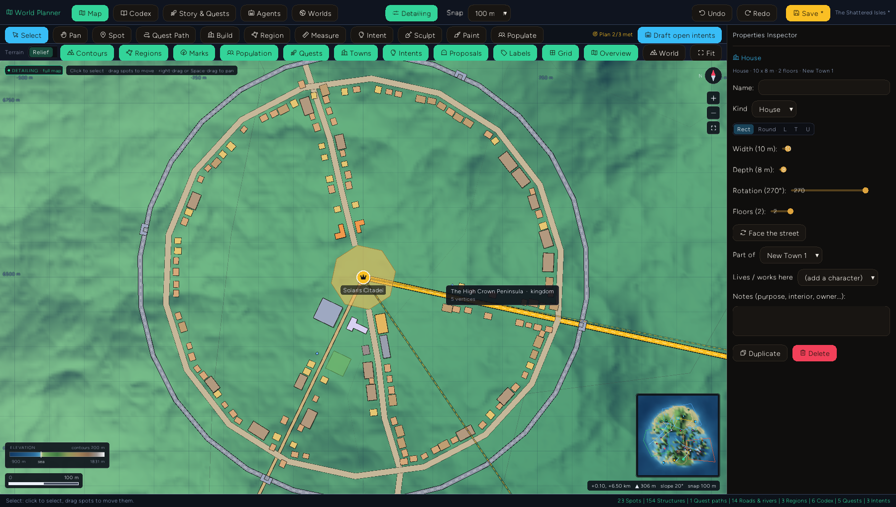
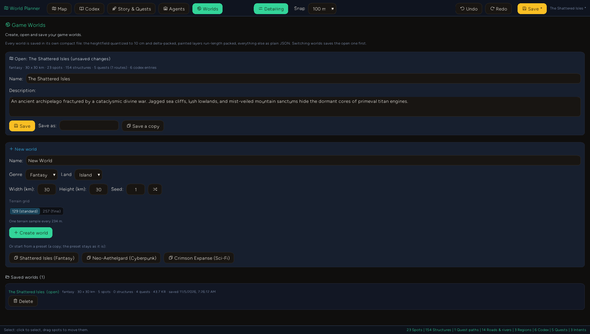
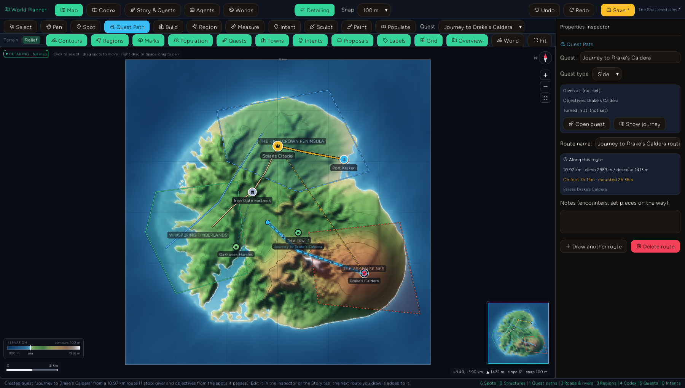

# Game World Planner: design intents and the agent loop

The Game World Planner (`cargo run --bin example -- game-planner`) is a topographic map editor for
game worlds: terrain with real drainage and contours, spots, roads, rivers, regions, travel times,
towns planned building by building, quests drawn as routes on the map, a codex and a quest
organizer, and a library of worlds you create and save (see [Worlds, towns and quest
paths](#worlds-towns-and-quest-paths)). This document covers the part that lets a designer **plan at the
level of vision and leave the building to agents**: design intents.

## The idea

Placing every village and routing every road by hand is implementation work. What a designer
actually knows is the intent: *"two quiet farming villages in these western lowlands"*, *"the walk
from the port to the caldera should take about four hours"*, *"something eerie in the southern
flats"*. The planner lets you sketch exactly that, on the map, and turns it into three things:

1. **A work order for agents.** Each intent carries its shape, your words, parameters and the
   spatial context an agent needs (terrain, what is inside and nearby, route ends).
2. **An acceptance test.** Every intent kind except freeform is checked against the world, live.
   The map shows ✓/✗ on every intent badge and the toolbar shows how much of the plan the world
   meets. Agents read the unmet ones as their queue; you see at a glance whether the world still
   matches your vision after any edit (move a spot and a pacing route re-times itself).
3. **A review surface.** Agents never edit the world. They file proposals, which appear on the map
   as violet previews (dashed roads, ringed spots, move arrows, region outlines). Click one to
   review it, accept (A) or reject (R) it, or accept a whole proposal at once. Every decision is one
   undo step.

## Sketching intents

Pick the **Intent** tool (`I`) and a shape in the toolbar:

| Shape | How | Kinds |
| ----- | --- | ----- |
| Pin   | one click | landmark, quest, freeform |
| Area  | click vertices, Enter or double-click to close | settle, danger, quest, freeform |
| Route | click start, click end (ends snap to spots and follow them when they move) | connect, pacing, freeform |

The kind defaults from the shape (area → settle, route → pacing, pin → landmark); choose one in the
toolbar or the inspector. Then write the directive in your own words. Simple patterns are read from
it - counts ("three", "2"), place types ("fishing villages" → ports, "keep" → fortress), threat
levels ("danger level 8"), travel times ("1 hour 30 minutes on horseback") - and fill any
parameter you haven't set explicitly. Precedence: the kind's defaults, then the directive, then what
you set in the inspector.

| Kind | Checked as met when |
| ---- | ------------------- |
| settle | at least *count* settlements (or spots of the chosen type) are inside the area |
| danger | a `danger` region at or above the threat level covers the area |
| landmark | a spot of the type is within the pin radius (4% of the world) |
| connect | a road (not a river) passes within 0.6 km of both ends |
| pacing | travel time between the ends, by the chosen mode, is within the tolerance of the target |
| quest | a mission's objective or start spot is in the area / at the pin |
| freeform | you mark it done (an LLM interprets it) |

With nothing selected, the inspector shows the **Plan Board**: every intent, its check, and a
health score.

## The built-in Planner Agent

**Draft with Planner Agent** (or **Draft open intents** for all of them) answers an intent from the
world's own data, offline and deterministically:

- **settle**: scores every terrain cell inside the area (dry, gentle, low, well-watered, coastal for
  ports), places the requested number of places at a spacing that fits the area, names them in the
  genre's style, and routes a road from each to its nearest neighbor with A* over the terrain.
- **danger**: a danger region over the area (or raises an existing one) and a lair - camp, dungeon
  or boss by threat level - in the area's most remote high ground.
- **landmark**: a spot at the pin, nudged onto the nearest land if the pin is in water.
- **connect**: a terrain-routed road (or the trail/highway you asked for).
- **pacing**: too long → it tries a trail, a road and a highway along a terrain route and proposes
  whichever lands nearest the target (a highway can overshoot as badly as nothing); too short → it
  moves the destination spot along the bearing until the journey takes the target time.
- **quest**: a mission given and turned in at the nearest settlement, with its objective an existing
  spot in the area or a new quest site.
- **freeform**: declines; that is what LLM agents are for.

## External agents (MCP)

The same loop is open to any agent through the addon's MCP tools:

| Tool | Purpose |
| ---- | ------- |
| `game_planner_list_intents` | the open intents with full context and acceptance criteria, plus the Markdown brief |
| `game_planner_claim_intent` | mark an intent as yours (`intentId` or `intentNumber`); the map shows who has it |
| `game_planner_create_intent` | sketch an intent from a conversation ("make the north dangerous") |
| `game_planner_propose_revision` | file changes for review; pass `intentId`/`intentNumber` |
| `game_planner_proposal_status` | what the designer accepted or rejected |
| `game_planner_sample_terrain`, `game_planner_calculate_travel` | ground truth for placing things |

Proposals may be minimal: `add_spot { name, spotType, x, y }` gets its elevation from the terrain,
its color and icon from the type; `add_path { name, pathType, points }` gets width and surface from
the type; `modify_spot { targetId, after: { x, y } }` records the old position so the map can draw
the move. Supported change types: `add_spot`, `modify_spot`, `delete_spot`, `add_path`,
`modify_path`, `delete_path`, `add_region`, `modify_region`, `add_mission`, `add_codex`. Invalid
changes come back in `errors` and are not filed.

Without MCP, **Copy Agent Brief** (Agents tab) puts a Markdown work order on the clipboard - world
summary, every unmet intent with its context and done-when criteria, and the proposal format - to
paste into any chat. **Copy context for an agent** does the same for one intent as JSON.

Intents also appear in the Game Design Document (section 7, with ✓/✗) and in the SVG map export.

## Planning in depth: terrain, biomes, population, quests

Intents say *what* you want; these tools let you plan the ground, the ecology, who lives where and
how quests play, on the same map. With nothing selected, the map's sidebar holds the Plan Board,
the active tool's settings, and the **Terrain & Procedural** tools (heightfield, erosion, rivers,
settlements, points of interest) that used to have a tab of their own. The **World** button in
the layer bar clears the selection to get back to it.

### Sculpt (E): terrain editing

| Mode | How | What it does |
| ---- | --- | ------------ |
| Raise, Lower, Smooth, Flatten, Roughen | drag a brush (`[` `]` resize it) | build up, dig, soften, level (to the ground where the stroke starts, or a set height), add broken relief |
| Canyon | click along its course, Enter | cuts a floor `depth` below the ground with walls up to the rim; the floor runs downhill from the first point, so water could follow it ("Run a river along its floor" adds one) |
| Mountain range | click along the spine, Enter | adds a crest of peaks and saddles that tapers at the ends, with ridged spurs on the flanks |
| Road bed | click along a road, Enter | cut and fill: the route's profile is smoothed and its grade capped (8% by default), shoulders blend into the land, water is left for bridges; and lays a trail, road or highway on it ("Lay on it", or nothing) |
| Plateau / pad | outline an area, Enter | levels it to the mean ground (or a set height) with a soft edge |

Every stroke is one undo step. A selected road has **Grade terrain along it**; a river **Carve a
canyon for it**; a spot **Level ground here** (a building pad of the radius you pick).

**Snap to Landscape.** Spots have a *Snap to landscape* checkbox, on by default: the spot's
elevation is the ground's and follows it through drags and terrain edits. Turn it off for a sky
citadel or a tower top and the elevation field becomes editable and stays put when the terrain
changes (typing an elevation turns the snap off). Flatten and Plateau have the same checkbox for
their target height.

### Paint (N): planning marks

Paint marks where forest, jungle, pine, meadow, farmland, scrub, marsh, sand, rock, snow, ash,
blight, ruins or built-up ground should be. Marks are drawn as symbols (trees, tufts, hatching,
dots) over a soft tint, never as real foliage: they are a plan for artists and level builders.
The brush can be confined to a region ("Only inside", or **Paint inside this region** from the
region). A mark replaces other surface marks under it unless you untick that.

Regions read the paint: the region inspector lists what is painted inside (share and km²),
suggests a biome from it ("Paint says forest (64% forest) - use it"), fills or clears the outline
with a mark, and has a **Biome & regional plan**: climate, flora, fauna, resources, mood / light /
music, level range and notes, plus the faction that holds it.

### Populate (U): enemies and NPCs from the Codex

The Codex has a **Bestiary** (creature) category next to characters. With Populate, a click places
the chosen entry (a named NPC, a pack of 4 enemies, an outpost) and a drag paints where it roams.
Placements carry a count, behavior (static, wander, patrol, guard, ambush, spawner, vendor, quest
giver), level range and notes, can be dragged, and say which spot and region they are in. Deleting
a codex entry removes its placements and painted presence.

### Codex, story and quests on the map

- A spot lists its linked codex entries (link and unlink both ways), the quests given, pursued or
  turned in there, and who is there.
- A codex entry has **On the map**: linked spots, placements, painted area, the regions it appears
  in and the quests that name it, with **Place on map** and **Paint where it roams**.
- A quest's **Show on map** draws its journey (giver `!`, numbered objectives, turn-in `?`) and
  focuses the map on it; the **Quests** layer shows every quest's route faintly.

### Richer quests (all optional)

On top of quest giver, objective spots and prerequisites, a quest can say:

- **who** gives it (a character, not only a place) and its **hook**;
- **what happens at each objective**: go, talk to, defeat, collect, escort, defend, investigate,
  deliver, use; with a target from the codex, a count, optional, minutes and a note;
- the **level range**, codex **rewards** (items, powers) and faction **standing**;
- **outcomes**: endings or choices, each opening its own follow-up quests.

The **Planning check** reads all of it against the map: the journey's time over the real terrain and
roads leg by leg plus time spent at objectives; the most dangerous objective against the quest's
level (one danger step per five levels is "comfortable" - a heuristic); whether the creature to
defeat or the NPC to talk to is actually placed or painted near the objective, and whether the
giver is at the giver spot; enemies painted along the way; prerequisites that come later in the
story or are tuned for a higher level; what the quest unlocks and how deep in its chain it is. All
of it goes into the Game Design Document.

### MCP

| Tool | Purpose |
| ---- | ------- |
| `game_planner_sculpt_terrain` | any sculpt mode along points, with its parameters |
| `game_planner_paint_marks` | paint (or fill a polygon with) a mark or a codex entry's presence |
| `game_planner_place_codex` | place a codex entry with count, behavior, levels |
| `game_planner_quest_plan` | read or update a quest's planning detail and get its planning check |

## Worlds, towns and quest paths

### The world library

The **Worlds** tab lists every saved world (name, genre, size, counts, file size, when it was saved)
and opens, copies or deletes them. **New world** makes an empty world on generated terrain: name,
genre, width and height in km, seed, land (island, archipelago, continent, highlands, lowlands)
and the terrain grid (129 standard, 257 fine). A preset is now a starting point: "start from a
preset" makes a copy, and the preset itself is never changed. Switching worlds saves the open one
first; Ctrl+S saves; the header shows the open world's name and `*` for unsaved changes.

Worlds live in the addon's store, `<data>/game-world-planner/worlds/<id>.world.json`, with a small
`index.json` (rebuilt from the files if it goes missing). The addon's own `game-world-planner.json`
now holds only settings (the open world, the surface detail). A world saved by an older version in
that file is moved into the library the first time this version starts.

The file is JSON in a format sized for the data:

| Part | Stored as |
| ---- | --------- |
| heightfield | 10 cm steps (16 bits; taller reliefs get coarser steps), predicted from the west, north and north-west samples (the LOCO-I median edge detector), residuals as zigzag varints in base64: 1-2 bytes a sample instead of 6-10 characters of JSON |
| painted marks | each layer as bytes (density x 255) with runs of empty cells collapsed |
| everything else | plain JSON, numbers rounded to 4 decimals (0.1 m in km), no whitespace |

Measured on the Shattered Isles with a laid-out capital (157 structures) and a quest route: 143 KB
as plain JSON, 72 KB in this format on the 129 x 129 grid; on a 257 x 257 grid, 505 KB against
155 KB. The
format carries a version (`"format": "entropy-game-world", "version": 2`); bare worlds (the old
format) still load.

### Surface detail up close

The heightfield is a grid (129 x 129 by default, a sample every ~230 m on a 30 km world). Zoomed in
past it, the map used to stretch each cell across hundreds of pixels and the ground went soft.
Now, once a cell is more than a few pixels wide, the visible part of the world is drawn as a fine
screen-space mesh (~45k vertices, rebuilt only when the view changes): elevations re-sampled with
Catmull-Rom (bicubic) interpolation, shaded per vertex, plus fractal micro-relief scaled to the cell
size and the slope. **Detail** in the layer bar sets it: Off (the grid as is), Normal, High. The
micro-relief is surface texture for reading the ground, not data: it never turns land into water or
water into land, and elevations, contours, travel and sculpting all use the heightfield.

For real detail, **Terrain & Procedural** re-samples the heightfield to 257 x 257 (bicubic, one
undo step), which gives the Sculpt brushes, road beds and building pads four times the samples.

### Towns and locations: the Build tool (K)

Zoomed in on a settlement, plan it building by building. **Build** places footprints: house, hall,
inn, shop, smithy, temple, keep, tower, barracks, warehouse, workshop, farmhouse, barn, mill, dock,
well, gatehouse, each with a default shape and size in meters. Footprints are rect, round, L, T or U;
walls and streets are clicked out as lines with a width; squares, markets, gardens and fields as
outlines. A new building faces the nearest street or road (within 60 m) unless you turn that off;
`,` and `.` turn the next one by 15 degrees. The cursor shows the footprint before you click.

Drag a building to move it; drag the handle behind a selected building to turn it (it snaps to 15
degrees). The inspector edits name, kind, shape, size, rotation, floors, which settlement it belongs
to (the nearest when placed), who lives or works there (characters from the Codex) and notes.

**Lay out** (a settlement spot's **Town plan** card, or the Build panel) drafts the whole place from
its type in one undo step: radial streets (and a ring for towns and up), a square or market, the
landmarks near the middle (inn, temple, hall, smithy; the keep for a capital), houses along the
streets facing them, walls with gatehouses around a city or capital, docks on the nearest shore for
a port, fields around a village. Roads already running through town are kept clear and lined with
houses; water and ground steeper than 24 degrees are left empty. "Lay out again" drafts a variant.
Moving the spot moves its town. The town plan goes into the Game Design Document and the SVG export.

### Quest Paths (L)

What used to be the Path tool is now **Quest Path**: a route always belongs to a quest. Draw from the
place the quest is given through the places the player goes (points snap to spots) and press Enter:

- with **+ New quest** chosen, a quest is made from the route: the first spot is the giver, the
  other spots the route passes are the objectives in order, and a route that returns to its start is
  turned in there. The next route you draw goes to the same quest.
- with an existing quest chosen, the route is added to it, filling only what it lacks (a giver,
  objectives it does not have, a turn-in).

Quest paths are drawn in the quest's color (main amber, side cyan, faction violet), dashed with
direction chevrons, from a `!` to a flag. The inspector shows the quest's giver, objectives and
turn-in, and the travel time **along the drawn route** (Naismith's rule on the sampled
slope, quicker on roads, slow through water) on foot and mounted. A quest's Story page lists its
routes and has **Draw its route on the map**. Route points on a spot follow it when it moves;
deleting a quest deletes its routes.

Quest paths are plans, not roads: travel times, the road network and "connect" intents ignore them.
Physical roads and rivers are made by the tools that shape the ground for them: Sculpt > Road bed
lays a trail, road or highway; Sculpt > Canyon can run a river; the procedural tools and agent
proposals build both. Existing roads and rivers are selected and edited as before.

### MCP

| Tool | Purpose |
| ---- | ------- |
| `game_planner_worlds` | `list`, `save`, `new` (name, genre, size, seed, landform, resolution), `open`, `save_as`, `from_preset`, `delete` |
| `game_planner_quest_path` | draw a route (points, optional `missionId`): makes or wires up the quest, returns the travel time along it |
| `game_planner_build` | `place` a building, a `line` (wall, street), an `area` (plaza, field...), `layout` a settlement, `clear` it, `list` |
| `game_planner_view` | center and zoom the map, set the surface detail, pick a tool |

## Detailing in 3D: the Game World Detailer

The [Game World Detailer](GAME_WORLD_DETAILER.md) opens these same world files in 3D with every
planned thing as a Mesha model. The Planner keeps the Detailer's section (`world.detail`) untouched
and watches the open world's file: when the Detailer saves (a building moved or turned, an NPC
moved, a model chosen), the Planner takes it in, or, with unsaved edits of its own, merges it with
them field by field (`world_sync.ts`); conflicts keep the Planner's value and the status line says
so. Every save first takes in what the Detailer saved since. Files record who saved them
(`savedBy`).

## Code

- `examples/studio-bundle/src/apps/game_planner/intent_model.ts` - intents, directive parsing, live
  checks, plan health, agent context and brief.
- `.../planner_agent.ts` - the built-in Planner Agent and normalization of external proposals.
- `.../agent_pipeline.ts` - applying and rejecting changes, ghost previews, GDD and SVG export.
- `.../planner_model.ts` - intent CRUD, sketching state, the proposal inbox with undo.
- `.../terrain_sculpt.ts` - brushes, canyons, mountain ranges, road beds, plateaus.
- `.../planning_layers.ts` - painted marks, codex placements, region and codex map summaries.
- `.../quest_planning.ts` - quest objective detail and the planning check.
- `.../world_sync.ts` - noticing the Detailer's saves and the three-way merge.
- `.../world_store.ts` - the world file format (terrain and paint encodings), the library, new worlds.
- `.../town_planning.ts` - structure kinds and footprints, street alignment, laying out a settlement.
- `.../quest_paths.ts` - quests from drawn routes, travel along a route.
- `src/entropy_gui/widgets_game_map.rs` - the fine terrain mesh (`build_fine_terrain`,
  `terrain_detail`), structures (`MapStructure`: fill, drag, rotation handle, `StructureMoved` /
  `StructureRotated` events), the Build cursor (`MapBuildCursor`), quest paths (paths of type
  `quest`); intent and ghost layers (`MapIntent`, `MapGhost`), their
  hit-testing, tooltips and mini-map markers; painted marks (`MapOverlay`), codex markers
  (`MapMarker`), quest routes (`MapQuestRoute`) and the brush (`MapBrush`, `BrushStroke` events).

Tests: `npm run test:game-planner` in `examples/studio-bundle` (includes
`tests/game_planner_intents.test.ts`, `tests/game_planner_planning.test.ts`,
`tests/game_planner_worlds.test.ts` and `tests/game_planner_towns_quests.test.ts`), and the live window test `tests/game_planner_live.rs`
(`xvfb-run -a cargo test --test game_planner_live` on Linux after `npm run build-game-planner`),
which sketches intents with real pointer input, runs the Planner Agent, rejects a proposal, and
answers an intent as an external agent over MCP, then sculpts a canyon and a mountain range with
real clicks, drags a raise brush, paints forest, places and paints a creature, and shows a quest on
the map; draws a quest path that becomes a quest, lays out the capital, places, drags and turns a
building up close with surface detail on, creates a new world, reopens the first one with its town
and route intact, and starts a world from a preset.

