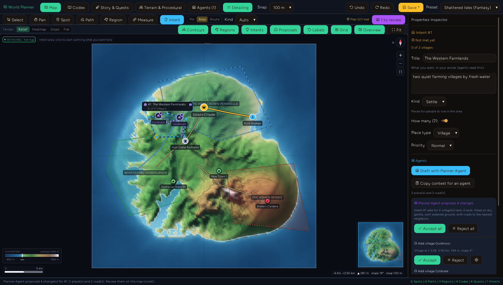
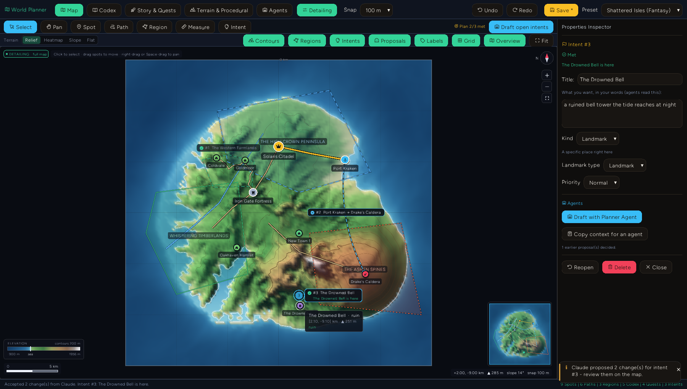

# Game World Planner: design intents and the agent loop

The Game World Planner (`cargo run --bin example -- game-planner`) is a topographic map editor for
game worlds: terrain with real drainage and contours, spots, roads, rivers, regions, travel times,
a codex and a quest organizer. This document covers the part that lets a designer **plan at the
level of vision and leave the building to agents**: design intents.

## The idea

Placing every village and routing every road by hand is implementation work. What a designer
actually knows is the intent: *"two quiet farming villages in these western lowlands"*, *"the walk
from the port to the caldera should take about four hours"*, *"something eerie in the southern
flats"*. The planner lets you sketch exactly that, on the map, and turns it into three things:

1. **A work order for agents.** Each intent carries its shape, your words, parameters and the
   spatial context an agent needs (terrain, what is inside and nearby, route ends).
2. **An acceptance test.** Every intent kind except freeform is checked against the world, live.
   The map shows ✓/✗ on every intent badge and the toolbar shows how much of the plan the world
   meets. Agents read the unmet ones as their queue; you see at a glance whether the world still
   matches your vision after any edit (move a spot and a pacing route re-times itself).
3. **A review surface.** Agents never edit the world. They file proposals, which appear on the map
   as violet previews (dashed roads, ringed spots, move arrows, region outlines). Click one to
   review it, accept (A) or reject (R) it, or accept a whole proposal at once. Every decision is one
   undo step.

## Sketching intents

Pick the **Intent** tool (`I`) and a shape in the toolbar:

| Shape | How | Kinds |
| ----- | --- | ----- |
| Pin   | one click | landmark, quest, freeform |
| Area  | click vertices, Enter or double-click to close | settle, danger, quest, freeform |
| Route | click start, click end (ends snap to spots and follow them when they move) | connect, pacing, freeform |

The kind defaults from the shape (area → settle, route → pacing, pin → landmark); choose one in the
toolbar or the inspector. Then write the directive in your own words. Simple patterns are read from
it - counts ("three", "2"), place types ("fishing villages" → ports, "keep" → fortress), threat
levels ("danger level 8"), travel times ("1 hour 30 minutes on horseback") - and fill any
parameter you haven't set explicitly. Precedence: the kind's defaults, then the directive, then what
you set in the inspector.

| Kind | Checked as met when |
| ---- | ------------------- |
| settle | at least *count* settlements (or spots of the chosen type) are inside the area |
| danger | a `danger` region at or above the threat level covers the area |
| landmark | a spot of the type is within the pin radius (4% of the world) |
| connect | a road (not a river) passes within 0.6 km of both ends |
| pacing | travel time between the ends, by the chosen mode, is within the tolerance of the target |
| quest | a mission's objective or start spot is in the area / at the pin |
| freeform | you mark it done (an LLM interprets it) |

With nothing selected, the inspector shows the **Plan Board**: every intent, its check, and a
health score.

## The built-in Planner Agent

**Draft with Planner Agent** (or **Draft open intents** for all of them) answers an intent from the
world's own data, offline and deterministically:

- **settle**: scores every terrain cell inside the area (dry, gentle, low, well-watered, coastal for
  ports), places the requested number of places at a spacing that fits the area, names them in the
  genre's style, and routes a road from each to its nearest neighbor with A* over the terrain.
- **danger**: a danger region over the area (or raises an existing one) and a lair - camp, dungeon
  or boss by threat level - in the area's most remote high ground.
- **landmark**: a spot at the pin, nudged onto the nearest land if the pin is in water.
- **connect**: a terrain-routed road (or the trail/highway you asked for).
- **pacing**: too long → it tries a trail, a road and a highway along a terrain route and proposes
  whichever lands nearest the target (a highway can overshoot as badly as nothing); too short → it
  moves the destination spot along the bearing until the journey takes the target time.
- **quest**: a mission given and turned in at the nearest settlement, with its objective an existing
  spot in the area or a new quest site.
- **freeform**: declines; that is what LLM agents are for.

## External agents (MCP)

The same loop is open to any agent through the addon's MCP tools:

| Tool | Purpose |
| ---- | ------- |
| `game_planner_list_intents` | the open intents with full context and acceptance criteria, plus the Markdown brief |
| `game_planner_claim_intent` | mark an intent as yours (`intentId` or `intentNumber`); the map shows who has it |
| `game_planner_create_intent` | sketch an intent from a conversation ("make the north dangerous") |
| `game_planner_propose_revision` | file changes for review; pass `intentId`/`intentNumber` |
| `game_planner_proposal_status` | what the designer accepted or rejected |
| `game_planner_sample_terrain`, `game_planner_calculate_travel` | ground truth for placing things |

Proposals may be minimal: `add_spot { name, spotType, x, y }` gets its elevation from the terrain,
its color and icon from the type; `add_path { name, pathType, points }` gets width and surface from
the type; `modify_spot { targetId, after: { x, y } }` records the old position so the map can draw
the move. Supported change types: `add_spot`, `modify_spot`, `delete_spot`, `add_path`,
`modify_path`, `delete_path`, `add_region`, `modify_region`, `add_mission`, `add_codex`. Invalid
changes come back in `errors` and are not filed.

Without MCP, **Copy Agent Brief** (Agents tab) puts a Markdown work order on the clipboard - world
summary, every unmet intent with its context and done-when criteria, and the proposal format - to
paste into any chat. **Copy context for an agent** does the same for one intent as JSON.

Intents also appear in the Game Design Document (section 7, with ✓/✗) and in the SVG map export.

## Code

- `examples/studio-bundle/src/apps/game_planner/intent_model.ts` - intents, directive parsing, live
  checks, plan health, agent context and brief.
- `.../planner_agent.ts` - the built-in Planner Agent and normalization of external proposals.
- `.../agent_pipeline.ts` - applying and rejecting changes, ghost previews, GDD and SVG export.
- `.../planner_model.ts` - intent CRUD, sketching state, the proposal inbox with undo.
- `src/entropy_gui/widgets_game_map.rs` - intent and ghost layers (`MapIntent`, `MapGhost`), their
  hit-testing, tooltips and mini-map markers.

Tests: `npm run test:game-planner` in `examples/studio-bundle` (includes
`tests/game_planner_intents.test.ts`), and the live window test `tests/game_planner_live.rs`
(`xvfb-run -a cargo test --test game_planner_live` on Linux after `npm run build-game-planner`),
which sketches intents with real pointer input, runs the Planner Agent, rejects a proposal, and
answers an intent as an external agent over MCP.

